<p align="center">
  
</p>

<h1 align="center">SimuPharma</h1>
<p align="center">
  <strong>Virtual Pharmaceutical Laboratory — Interactive Instrument Simulations Powered by AI</strong>
</p>

<p align="center">
  
  
  
  
</p>

---

## What is SimuPharma?

SimuPharma is a browser-based platform that provides **scientifically accurate, interactive simulations** of analytical instruments used in pharmaceutical laboratories. Built for pharmacy students, educators, and researchers — no expensive hardware required.

### 🧪 7 Instrument Simulators

| Instrument | Physics Engine | Key Feature |
|-----------|---------------|-------------|
| **HPLC** | Van Deemter plate theory | Full chromatogram simulation |
| **FTIR** | FFT spectroscopy | Functional group identification |
| **UV-Vis** | Beer-Lambert Law | Calibration curves with R² |
| **GC** | Temperature programming | Volatile compound analysis |
| **Mass Spec** | Fragmentation + isotope patterns | EI/CI ionization modes |
| **Polarimeter** | Optical rotation | Temperature/wavelength corrections |
| **PSA** | Laser diffraction | D10/D50/D90 distribution |

### 🧠 AI-Powered Features

- **Autonomous Lab Agent** — Plans and executes multi-instrument experiments via Gemini AI
- **Adaptive Learning** — Bayesian Knowledge Tracing adjusts difficulty per student
- **Knowledge Graph** — Pharmaceutical concept DAG for personalized learning paths
- **ML Compound ID** — Identify unknowns from spectral data across multiple instruments

---

## Quick Start

### Prerequisites
- Python 3.12+
- Node.js 18+ (optional, for virtual lab)

### 1. Clone & Setup

```bash
git clone https://github.com/your-org/simupharma.git
cd simupharma
```

### 2. Configure Environment

```bash
cp .env.example .env
# Edit .env with your settings (especially SIMUPHARMA_SECRET_KEY and GEMINI_API_KEY)
```

### 3. Install Dependencies

```bash
python -m venv .venv
# Windows:
.venv\Scripts\activate
# macOS/Linux:
# source .venv/bin/activate

pip install -r backend/requirements.txt
```

### 4. Run the Backend

```bash
uvicorn backend.main:app --reload --port 8000
```

### 5. Open the Frontend

Open `index.html` in a browser (or use Live Server in VS Code on port 5500).

**API Docs:** [http://localhost:8000/docs](http://localhost:8000/docs)

---

## Docker

```bash
# Start everything (API + PostgreSQL + Frontend)
docker compose up

# API:      http://localhost:8000
# Frontend: http://localhost:5500
# Docs:     http://localhost:8000/docs
```

---

## Architecture

```
simupharma/
├── index.html              # Landing page
├── *_simulator.html        # Individual instrument simulators
├── backend/
│   ├── main.py             # FastAPI app + simulation endpoints
│   ├── config.py           # Environment-based configuration
│   ├── database.py         # SQLAlchemy (SQLite/PostgreSQL)
│   ├── models.py           # User, Experiment, QuizResult, Progress
│   ├── auth/               # JWT authentication + rate limiting
│   ├── science/            # Simulation engines (7 instruments)
│   ├── compounds/          # 20+ pharmaceutical compound database
│   ├── analytics/          # ML spectral matching & identification
│   ├── neural/             # AI agent, adaptive engine, knowledge graph
│   └── experiments/        # Experiment logging
├── tests/                  # Pytest test suite
├── Dockerfile              # Production container
├── docker-compose.yml      # Full stack (API + DB + Frontend)
└── .env.example            # Environment variable template
```

---

## API Overview

| Endpoint | Method | Description |
|----------|--------|-------------|
| `/api/health` | GET | Health check |
| `/api/auth/register` | POST | User registration |
| `/api/auth/login` | POST | User login (JWT) |
| `/api/simulate/uvvis` | POST | UV-Vis spectrum |
| `/api/simulate/ftir` | POST | FTIR spectrum |
| `/api/simulate/hplc` | POST | HPLC chromatogram |
| `/api/simulate/gc` | POST | GC chromatogram |
| `/api/simulate/mass-spec` | POST | Mass spectrum |
| `/api/simulate/polarimeter` | POST | Optical rotation |
| `/api/simulate/psa` | POST | Particle size distribution |
| `/api/analyze/identify` | POST | ML compound identification |
| `/api/neural/agent/*` | POST | AI lab agent |

Full API docs at `/docs` (Swagger UI) or `/redoc`.

---

## Testing

```bash
pytest tests/ -v
```

---

## Tech Stack

| Layer | Technology |
|-------|-----------|
| Frontend | HTML5, CSS3, JavaScript (Vanilla) |
| Backend | FastAPI, SQLAlchemy, Pydantic |
| Database | SQLite (dev) / PostgreSQL (prod) |
| AI | Google Gemini API (autonomous agent) |
| ML | NumPy, SciPy, scikit-learn |
| Auth | JWT (python-jose) + bcrypt (passlib) |
| Deployment | Docker, Nginx |

---

## Contributing

This project is currently in stealth mode. Contact the maintainers for contribution guidelines.

---

## License

Proprietary — All rights reserved. © 2026 SimuPharma.
