# STANDARDIZED INTERVENTION PROTOCOL
**Document ID:** P4-PROTOCOL-2026-REV1  
**Duration:** 50 Minutes Total (Single Lab Period)  
**Delivery Mode:** In-Person Supervised Computer Lab or Synchronous Virtual Lab Session  

---

## SESSION TIMELINE & ACTIVITY BREAKDOWN

```mermaid
gantt
    title Standardized 50-Minute SimuPharm Educational Session
    dateFormat mm
    axisFormat %M min
    section Orientation
    Ethics, Consent & Pre-Test : 00, 10
    section Instruction
    Platform Tour & Baseline Run : 10, 18
    section Fault Exploration
    Interactive Fault Injection Practice : 18, 30
    section Evaluation
    Unknown Practical Diagnostic Task : 30, 40
    Post-Test, SUS & Feedback : 40, 50
```

### Module 1: Pre-Intervention & Baseline (Minutes 00–10)
- **Activity:** Welcome, participant information sheet distribution, electronic consent collection.
- **Instrument:** 10-item Pre-Test administered via secure web form or printed questionnaire.
- **Constraint:** Strictly independent; no discussion permitted; no access to SimuPharm yet.

### Module 2: Simulator Orientation & Baseline Chromatography (Minutes 10–18)
- **Activity:** Instructor demonstrates the SimuPharm interface on projector/screen sharing:
  1. Setting mobile phase flow rate ($0.5–2.0	ext{ mL/min}$).
  2. Setting organic modifier fraction (%B: Acetonitrile).
  3. Selecting column stationary phase and column dimensions.
  4. Executing an isocratic injection of the analgesic mixture.
  5. Reading the real-time pressure gauge, chromatogram retention times ($t_R$), and peak widths ($w_{0.5}$).
- **Student Hands-On:** Each student independently loads SimuPharm in browser, executes a normal baseline run at $50\%$ B, $1.0	ext{ mL/min}$, and observes normal peak symmetry and steady pressure ($\sim 82	ext{ bar}$).

### Module 3: Guided Fault-Injection Exploration (Minutes 18–30)
- **Activity:** Students systematically activate and observe four classic instrument faults:
  1. **Fault 1 — Air Bubble in Pump Head:** Students toggle "Air Bubble". Observe transient pressure dips (-20 bar), optical noise spikes, and retention jitter.
  2. **Fault 2 — System / Fitting Leak:** Students toggle "System Leak". Observe persistent backpressure drop (-50 bar) and systematic elongation of all retention times (+30%).
  3. **Fault 3 — Column Inlet Void / Degradation:** Students toggle "Column Degradation". Observe severe peak splitting, asymmetric tailing ($T_f > 2.0$), and plate count collapse ($N$ loss $> 50\%$).
  4. **Fault 4 — Mobile Phase Contamination:** Students toggle "Contamination". Observe spurious ghost peaks and elevated baseline noise.
- **Guided Reflection:** Students refer to a 1-page symptom reference matrix comparing the 4 faults.

### Module 4: Practical Diagnostic Performance Task (Minutes 30–40)
- **Activity:** Students are presented with four unknown simulated runs (Scenario Alpha, Beta, Gamma, Delta).
- **Task:** For each scenario, students inspect the chromatogram and pressure gauge, record:
  1. Primary fault diagnosis.
  2. Diagnostic confidence (1 = Pure guess to 5 = Completely confident).
  3. Underlying physical reasoning.
  4. Immediate corrective action.
- **Timing:** Built-in timer records latency from scenario load to submission of diagnosis.

### Module 5: Post-Test, Usability & Feedback (Minutes 40–50)
- **Activity:** Students complete:
  1. 10-item Parallel Post-Test.
  2. 10-item System Usability Scale (SUS).
  3. Qualitative feedback form (open-ended questions on easiest/hardest aspects and suggested improvements).
- **Debrief:** Instructor reviews answers to unknown scenarios; study concludes.
