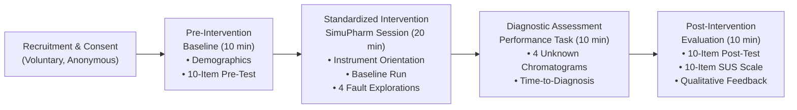

# STUDY DESIGN & METHODOLOGICAL FRAMEWORK
**Document ID:** P4-DESIGN-2026-REV1  
**Study Type:** Single-Group Pre-Test / Post-Test Exploratory Educational Pilot  
**Target Population:** Undergraduate B.Pharm / B.Sc. Chemistry Students  

---

## 1. STUDY DESIGN ARCHITECTURE

### Design Rationale: Why an Exploratory Single-Group Pilot?
For a *Journal of Chemical Education* Technology Report, an initial single-group pre-post pilot ($N = 20–30$) is the established gold standard for demonstrating educational feasibility and preliminary utility before committing departmental resources to a multi-semester randomized controlled trial.
- **Feasibility:** Allows complete evaluation within a single 50-minute laboratory or lecture period.
- **Ethical Parity:** Avoids withholding interactive software from an un-consented student control group within an accredited degree curriculum.
- **Formative Focus:** Optimizes collection of rich usability feedback and identification of student misconceptions.

---

## 2. THREATS TO INTERNAL VALIDITY & MITIGATION STRATEGIES

| Threat to Validity | Nature of Threat | Pre-Specified Mitigation Strategy |
| :--- | :--- | :--- |
| **Testing Effect / Item Memorization** | Students remember pre-test questions and answer post-test from memory. | **Parallel, Non-Identical Items:** Pre- and post-tests use isomorphic questions covering identical principles with different analytes, numerical parameters, and chromatogram appearances. |
| **Instrumentation Bias** | Pre-test and post-test differ in difficulty. | **Content Equivalence Blueprint:** Both instruments were mapped onto identical cognitive levels (Bloom's Taxonomy) and reviewed by analytical faculty for equivalent difficulty. |
| **Investigator / Assessor Bias** | Graders award higher scores to post-tests to demonstrate software success. | **Blind, De-Identified Scoring:** Pre- and post-test responses are exported to anonymized numeric IDs; graders score randomized items without knowing whether an item is pre- or post-intervention. |
| **Maturation** | Natural learning occurs during the session from external factors. | **Short Intervention Window:** The entire session lasts under 50 minutes, precluding external study or multi-day maturation. |
| **Attrition Bias** | Frustrated students drop out, leaving only successful students. | **Complete Session Capture:** The study is embedded into a scheduled lab period; all consenting participants complete all sections in one sitting. |

---

## 3. CONTROLLED TRIAL BLUEPRINT (FUTURE MULTI-COHORT RCT)
While the present pilot uses a single-group design, the protocol establishes the design for a future comparative RCT across two academic semesters:
- **Cohort A (Control, $N = 35$):** Static troubleshooting manual (John Dolan troubleshooting flowcharts + paper chromatograms).
- **Cohort B (Intervention, $N = 35$):** Interactive SimuPharm software session.
- **Crossover:** Cohort A receives SimuPharm access after post-testing to ensure ethical instructional parity.
