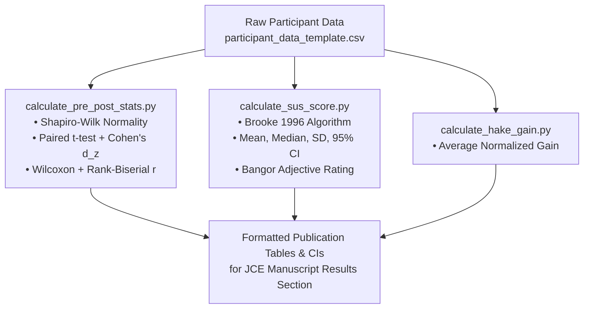

# ANALYSIS EXECUTION PROTOCOL & SCRIPT SPECIFICATIONS
**Document ID:** P4-ANL-PLAN-2026-REV1  
**Platform:** Python 3.10+ (NumPy, SciPy, Pandas, Statsmodels)  

---

## SCRIPT INVENTORY & WORKFLOW

### Script Execution Orders:
1. `python calculate_pre_post_stats.py [csv_path]`
2. `python calculate_sus_score.py [csv_path]`
3. `python calculate_hake_gain.py [csv_path]`
