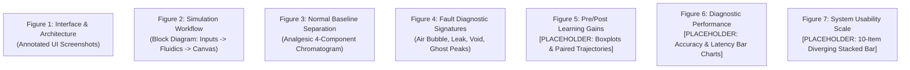

# MANUSCRIPT FIGURE PLAN & TECHNICAL SPECIFICATIONS
**Document ID:** P4-FIGS-2026-REV1  
**Target:** 7 High-Resolution Figures for *Journal of Chemical Education*  

---

## FIGURE SPECIFICATIONS

### Figure 1: SimuPharm User Interface & Modular Layout
- **Content:** Full-resolution labeled screenshot of SimuPharm:
  - (A) Mobile phase and column control sliders (Flow, %B, Temp, Column Type).
  - (B) Digital system status panel (Backpressure gauge, elapsed time, flow status).
  - (C) Real-time HTML5 chromatographic canvas with live peak rendering and baseline.
  - (D) Fault injection control console (Air Bubble, System Leak, Column Void, Contamination).
- **Format:** 300 DPI composite TIFF/PNG, labeled callouts (A, B, C, D).

### Figure 2: Chromatographic Simulation & Hydraulic Flow Architecture
- **Content:** Schematic flowchart depicting data flow:
  - User input parameters $	o$ Binary solvent viscosity calculation $	o$ Blake-Kozeny column backpressure $	o$ Solute retention integration $	o$ Peak dispersion / asymmetry calculation $	o$ Dynamic canvas rendering.

### Figure 3: Normal Baseline Chromatographic Profile
- **Content:** High-resolution simulated chromatogram of standard analgesic mixture under nominal conditions ($50\%$ B, $1.0	ext{ mL/min}$, $30^\circ	ext{C}$, C18):
  - Peak 1: Paracetamol ($t_R = 2.80	ext{ min}$, $w_{0.5} = 0.08	ext{ min}$)
  - Peak 2: Caffeine ($t_R = 3.50	ext{ min}$, $w_{0.5} = 0.09	ext{ min}$)
  - Peak 3: Aspirin ($t_R = 6.20	ext{ min}$, $w_{0.5} = 0.11	ext{ min}$)
  - Peak 4: Ibuprofen ($t_R = 9.00	ext{ min}$, $w_{0.5} = 0.14	ext{ min}$)
  - Inset: System backpressure readout ($82.5	ext{ bar}$) with smooth, steady baseline.

### Figure 4: Visual Diagnostic Signatures of Simulated Equipment Faults
- **Content:** Four-panel comparative chromatogram figure:
  - (A) **Air Bubble:** Transient pressure dips (-20 bar), sharp cyclical baseline spikes.
  - (B) **System Leak:** Reduced steady backpressure (-50 bar), elongated retention times (+30%).
  - (C) **Column Inlet Void:** Split doublet peaks across all solutes, pronounced tailing ($T_f = 2.50$).
  - (D) **Contamination:** Unassigned ghost peaks eluting across baseline with elevated noise.

### Figure 5: Pre-Test vs Post-Test Assessment Performance [PLACEHOLDER]
- **Content:** (To be generated upon real data collection)
  - Paired trajectory plot showing individual student score changes from Pre-Test to Post-Test.
  - Inset: Box-and-whisker plot displaying mean, median, IQR, and 95% confidence intervals.

### Figure 6: Practical Unknown Diagnostic Task Accuracy & Latency [PLACEHOLDER]
- **Content:** (To be generated upon real data collection)
  - Clustered bar chart showing diagnostic accuracy (%) across the four unknown scenarios.
  - Dual-axis overlay depicting median time-to-diagnosis in seconds.

### Figure 7: System Usability Scale (SUS) Item Breakdown [PLACEHOLDER]
- **Content:** (To be generated upon real data collection)
  - Diverging stacked bar chart displaying distribution of student responses (Strongly Disagree to Strongly Agree) across the 10 SUS items.
